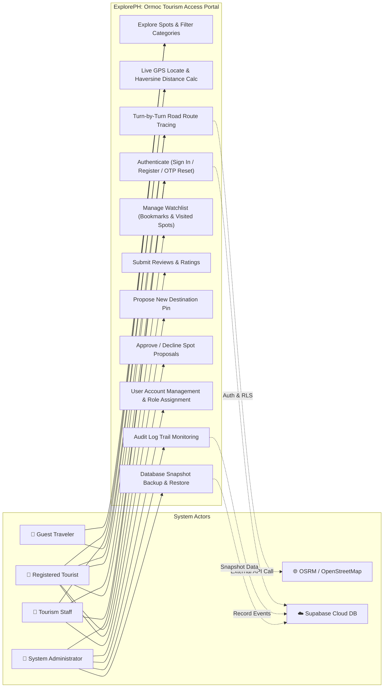
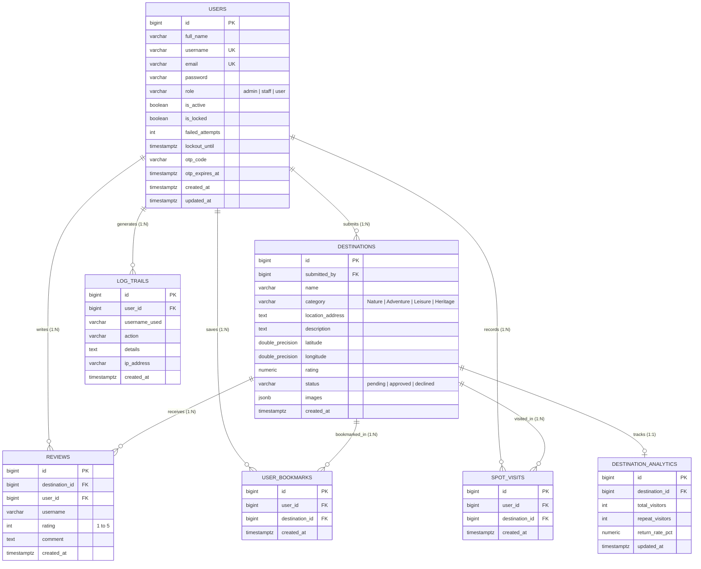
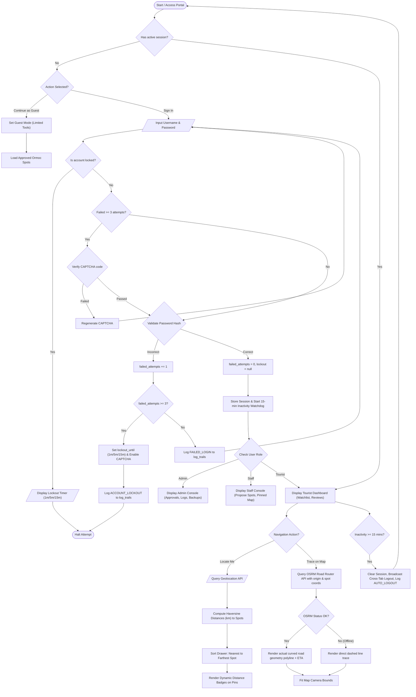

# System Integration and Architecture (SIA)
## Final Project Technical Specification & Architecture Manual
**System Title:** `ExplorePH: Ormoc Tourism Access & GPS Smart Navigation Portal`  
**Target Organization:** City Government of Ormoc / Tourism & Investment Promotions Office  
**Security & Architecture Standard:** IAS-1 Compliant / Cloud-Distributed Microservice Architecture

---

## 1. Use Case Diagram (System Users & Functionalities)

### Actors Identified:
1. **Tourist / Traveler (Primary User)**: Discovers destinations, views road route navigation, checks GPS distances, bookmarks spots, submits reviews, tracks visited locations.
2. **Tourism Staff / Content Manager (Authorized Contributor)**: Proposes new tourist spots, pins GPS coordinates, updates hours/fees/media.
3. **System Administrator (Governance & Security)**: Approves/declines destination proposals, manages user roles and locks, audits system security log trails, performs database snapshot backups & restores.
4. **Guest Traveler (Unauthenticated Actor)**: Browses public spot listings, searches destinations, views maps and GPS distances.
5. **External Routing & Geospatial Services (Secondary Actors)**: OpenStreetMap OSRM Routing Engine, Nominatim Geocoder, Leaflet Maps, Supabase BaaS.



---

## 2. System Flow Diagram (Swimlanes and Pools)

Illustrates the end-to-end operational handoff across participants: **Tourist**, **Tourism Staff (LGU)**, **System Admin**, and the **Automated Cloud Engine**.

```mermaid
sequenceDiagram
    autonumber
    actor Tourist as 👤 Tourist / User
    actor Staff as 🏛️ Tourism Staff (LGU)
    actor Admin as 🛡️ System Administrator
    participant System as 📱 ExplorePH Web Engine
    participant OSRM as 🛣️ OSRM Road Router
    participant DB as 🗄️ Database & Security Log

    %% Tourism Content Lifecycle
    rect rgb(24, 24, 24)
    note right of Staff: Phase 1: Destination Content Proposal
    Staff->>System: Pin GPS point, input spot details, hours, fee schedule
    System->>DB: INSERT INTO destinations (status='pending')
    DB-->>System: Stored as pending proposal
    System->>DB: INSERT INTO log_trails (action='SUBMIT_DESTINATION')
    end

    rect rgb(28, 20, 20)
    note right of Admin: Phase 2: Administrative Review & Governance
    Admin->>System: Review pending tourism proposals list
    alt Proposal Approved
        Admin->>System: Click "Approve Spot"
        System->>DB: UPDATE destinations SET status='approved'
        System->>DB: INSERT INTO log_trails (action='REVIEW_DESTINATION')
    else Proposal Declined
        Admin->>System: Click "Decline Spot"
        System->>DB: UPDATE destinations SET status='declined'
    end
    end

    rect rgb(20, 28, 24)
    note right of Tourist: Phase 3: Discovery, GPS Proximity & Road Tracing
    Tourist->>System: Open Portal, request live GPS position ("Locate Me")
    System->>System: Calculate Haversine Distances (km) to all Ormoc spots
    Tourist->>System: Click "Trace on Map" for Lake Danao
    System->>OSRM: GET /driving/{user_lng},{user_lat};{spot_lng},{spot_lat}
    OSRM-->>System: Return GeoJSON Road Network Coordinates & Duration
    System->>Tourist: Render high-fidelity road polyline on Leaflet canvas
    Tourist->>System: Mark spot as "Visited" or "Bookmark"
    System->>DB: UPSERT INTO spot_visits / user_bookmarks
    System->>DB: INSERT INTO log_trails (action='MARK_VISITED')
    end
```

---

## 3. Entity Relationship Diagram (ERD)

Defines all database entities, keys, field types, and relational cardinalities supporting **IAS-1 Security** and **Ormoc Tourism Data**:



---

## 4. System Flowchart (Core Logic & Decision Flow)

Represents system inputs, validation conditions, progressive lockouts, road tracing logic, and data storage workflows.



---

## 5. Network Diagram (Physical & Logical Infrastructure Flow)

Illustrates communication channels, encrypted protocol transport (`HTTPS/TLS 1.3`, `WSS`), firewalls, caching layers, application runtime, and external services.

```mermaid
flowchart TD
    subgraph ClientTier["Client Device Layer (Edge)"]
        Mobile["📱 Mobile Smartphone (GPS Enabled)"]
        Workstation["💻 Desktop / Admin Workstation"]
    end

    subgraph Perimeter["Perimeter Security & CDN"]
        DNS["🌐 DNS / Cloudflare Edge CDN (DDoS Protection)"]
        WAF["🛡️ Web Application Firewall & SSL Termination"]
    end

    subgraph WebServerTier["Application Hosting Tier (Local / Cloud Host)"]
        Apache["🖥️ Web Server (XAMPP Apache / Nginx Engine)"]
        StaticEngine["📦 Single Page Application (ExplorePH HTML5, Tailwind, Leaflet.js)"]
    end

    subgraph ExternalServices["External Geospatial Cloud Engines"]
        OSRM["🛣️ OpenStreetMap OSRM Driving Engine (router.project-osrm.org)"]
        OSMTiles["🗺️ OpenStreetMap Tile Servers ({s}.tile.openstreetmap.org)"]
        Nominatim["📍 Nominatim Reverse Geocoder API"]
    end

    subgraph DataTier["Managed Cloud Database Tier (Supabase)"]
        API_GW["🚪 PostgREST / GoTrue Auth Gateway (Port 443 HTTPS)"]
        PG_DB[("🐘 PostgreSQL Distributed Database (Tables, Keys, RLS)")]
        Storage[("🗄️ Supabase Object Storage (Destination Photos Bucket)")]
    end

    %% Network Connections
    Mobile -->|HTTPS / TLS 1.3 (Port 443)| DNS
    Workstation -->|HTTPS / TLS 1.3 (Port 443)| DNS
    DNS --> WAF
    WAF --> Apache
    Apache --> StaticEngine

    StaticEngine -->|HTTPS Tile Requests (Port 443)| OSMTiles
    StaticEngine -->|Turn-by-Turn Road Route Requests| OSRM
    StaticEngine -->|Reverse Coordinate Geocoding| Nominatim

    StaticEngine -->|RESTful CRUD & Auth (JWT Bearer Token)| API_GW
    API_GW -->|Connection Pool (PgBouncer)| PG_DB
    API_GW -->|Public CDN URL Fetch| Storage
```
